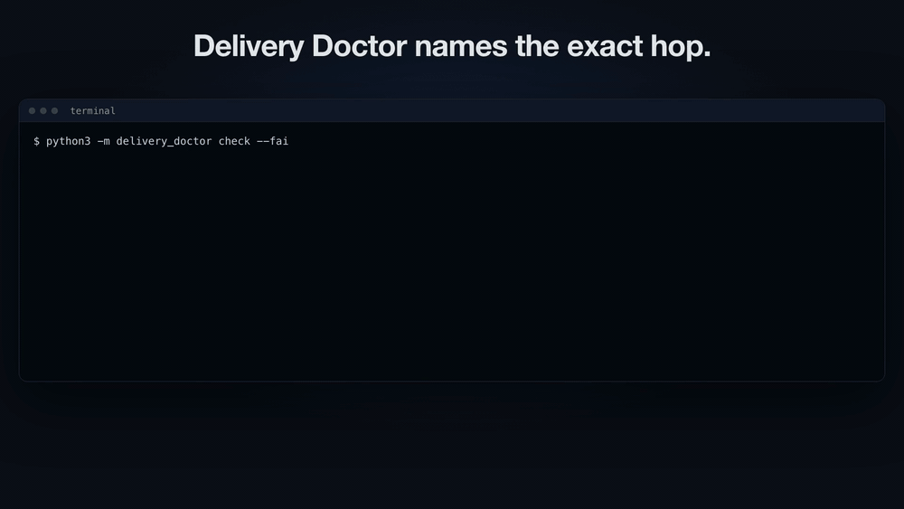

# Delivery Doctor

**Your agent sent the event. Your dashboard never got it. Delivery Doctor tells you which hop it died at.**

[](docs/demo.mp4)

*15 second demo: [docs/demo.mp4](docs/demo.mp4)*

One idea: agent telemetry can vanish in transit without a single error. The SDK buffers the event, the process exits 0, the logs stay clean, and the dashboard just comes up short. Delivery Doctor proves whether each event actually arrived at intake, and when one did not, it names the exact hop where it stopped and the fix. One command: `python3 -m delivery_doctor check`.

## What this is (and what it is not)

Delivery Doctor is a transport verifier. It answers one question: did the telemetry your agent emitted actually arrive at intake, and if not, exactly where did it stop?

It is not a local debugger. Raindrop's [Workshop](https://github.com/raindrop-ai/workshop), their open-source local debugger, already covers that ground: it streams every token, tool call, and span from your agent into a live local UI and lets your coding agent write evals against the traces. The two tools complement each other: Workshop shows you what your agent did locally, Delivery Doctor proves whether the data about it made it to the backend, and names the hop where it stopped when it did not.

## The problem

Agent observability SDKs are built so they never get in your way. `track()` returns right away, events sit in a buffer, batches go out in the background, and when something fails the SDK keeps quiet so your app keeps running.

The cost is that events vanish without a trace. The process exits before the buffer is flushed. A key expires. A proxy times out. A 1 MB tool output trips a payload limit. A burst overflows the in-memory queue. Your app logs nothing, the SDK logs nothing, and the dashboard just shows fewer events than it should. Nobody can say where they went.

## What Delivery Doctor does

Delivery Doctor sends tagged canary events through the SDK, then reads every one of them back from intake. For each event it lines up two independent records:

- **what the client did**: a delivery ledger the SDK appends to on every state change (buffered, dropped, attempt, retry, split, acked, rejected, failed)
- **what the server holds**: the intake log, read back over HTTP

Then it walks the hops in order and names the first one that failed, along with the fix and the raw evidence.

**The one hook this takes is the delivery ledger.** If the SDK records each state change an event goes through, pinpointing the client-side hop stops being a guess and becomes a lookup. That ledger (or equivalent counters) is the one thing a production SDK would need to add, and it is cheap: an append-only line per state change, no behavior change, no hot-path cost.

```
$ python3 -m delivery_doctor check --fail buffer
Delivery Doctor run 53d0d3eb  injected failure: buffer
endpoint: http://127.0.0.1:59325

EVENT ID         BUFFERED  SENT  HTTP  LANDED  STOP POINT / DETAIL
dd-53d0d3eb-000  yes       yes   200   yes     landed: in intake log (1 copy)
...
dd-53d0d3eb-009  yes       yes   200   yes     landed: in intake log (1 copy)
dd-53d0d3eb-010  yes       no    -     no      never sent by client (buffer drop): still in SDK buffer when the process exited
dd-53d0d3eb-011  yes       no    -     no      never sent by client (buffer drop): still in SDK buffer when the process exited

JSON report: .doctor_runs/53d0d3eb/report.json
FAIL: 10/12 landed; 2 never sent by client (buffer drop) (fix: call flush() before the process exits, or keep the SDK exit hook on).
```

## Quickstart

You need Python 3 (tested on 3.13). There are no runtime dependencies, nothing to sign up for, and no API keys. Everything runs on `127.0.0.1`.

```bash
git clone https://github.com/karank2512/delivery-doctor.git
cd delivery-doctor
python3 -m delivery_doctor check
```

A healthy run ends with `PASS: 12/12 events landed and were read back.` and exit code 0. Then break something on purpose:

```bash
python3 -m delivery_doctor check --fail expired-key
python3 -m delivery_doctor check --fail too-large --verbose
python3 -m delivery_doctor watch --fail rate-limit --duration 10
python3 -m delivery_doctor report --html report.html
```

## Features

**`check`**: one run, one verdict. It emits N canaries (`--n`, default 12), polls intake until every event the SDK thinks was delivered can be read back, and prints a hop-by-hop table.

- `--json` prints the full report as JSON, for CI and scripts
- `--verbose` lists every ledger and intake entry under each event, with millisecond offsets
- `--html PATH` also writes the HTML report
- `--gzip` has the SDK gzip request bodies

**`watch`**: tails a live emitter and redraws delivery health every second: tracked, landed, lost, and in flight counts, plus a histogram of stop points.

```
[   3.1s]  tracked 32    landed 5     lost 25    in flight 2
    rate_limited         ############################## 25
    landed               ###### 5
    in_flight            ## 2
```

By default it starts its own intake and a streaming sample agent (`--duration`, `--rate`, `--interval`). To watch an emitter you started yourself, point it at that emitter's ledger and intake: `watch --ledger sdk_ledger.jsonl --intake http://127.0.0.1:8787`. With `--json` it prints one JSON object per tick and a final report line. Events that are still buffered or being retried count as in flight while the emitter runs, not as lost.

**`report --html out.html`**: a single HTML file you can attach to a ticket. It has the verdict, summary stats, a stop-point histogram with fix hints, and a timeline row per event showing each hop (buffered, attempt, retry, split, acked, intake receipt) at its real time offset. Every row expands to its raw evidence. All CSS and JS is inline and the full report JSON is embedded, so the file works offline. It reads the latest run by default; `--from` takes a run id or a `report.json` path, and `--fail MODE` runs a new check first.

**Exit codes** for every command: `0` every event landed, `1` at least one event was lost, `2` usage error.

## Stop points

| Stop point | Hop | What the evidence shows |
|---|---|---|
| `landed` | intake | Intake log has an accepted record for the id |
| `rejected` | intake | Intake received it and rejected it; detail is the server's reason (for example `field 'timestamp' has wrong type str`) |
| `queue_overflow` | sdk | SDK dropped it at `track()` because its in-memory queue was full |
| `never_sent` | sdk | Buffered but never attempted; the process exited with it still in the buffer |
| `auth_invalid_key` | auth | HTTP 401, code `invalid_key` |
| `auth_expired_key` | auth | HTTP 401, code `key_expired` (a different fix from a wrong key, so it's a separate stop point) |
| `forbidden` | auth | HTTP 403, for example a Host or origin check in front of intake |
| `rate_limited` | intake | Retries ran out while intake kept answering 429 |
| `payload_too_large` | intake | HTTP 413 even after the SDK split the batch down to this single event |
| `send_timeout` | network | No response within the SDK timeout on every attempt |
| `send_failed_network` | network | Connection errors on every attempt |
| `send_failed_http` | intake | Any other HTTP error, with status and body |
| `acked_not_readable` | query | SDK got a 200, but intake has no record (ingest or query path lost it) |
| `never_tracked` | app | No ledger entry; the app never called `track()` |

## Failure injection

Every failure is reproduced for real by the mock SDK, sample agent, or intake. Nothing is faked in the classifier. Pass any of these to `check`, `watch`, or `report` with `--fail`:

| `--fail` | What it simulates | Expected result (12 canaries) |
|---|---|---|
| `auth` | SDK configured with a wrong API key | 12 `auth_invalid_key` |
| `expired-key` | SDK configured with an expired key | 12 `auth_expired_key` |
| `schema` | every 4th event sends `timestamp` as a string | 9 landed, 3 `rejected` |
| `buffer` | app exits without `flush()` and without the SDK exit hook | 10 landed, 2 `never_sent` |
| `network` | SDK points at a port with nothing listening | 12 `send_failed_network` |
| `rate-limit` | intake answers 429 after the first batch | 5 landed, 7 `rate_limited` |
| `too-large` | every 6th event carries a 1 MB attachment (limit 256 KB) | 10 landed, 2 `payload_too_large` |
| `timeout` | intake hangs longer than the SDK's 0.25s timeout | 12 `send_timeout` |
| `overflow` | SDK queue capped at 8; the app bursts past it | 8 landed, 4 `queue_overflow` |

`python3 -m delivery_doctor check --help` prints the same list.

## How the mock SDK behaves

`mock_raindrop/sdk.py` copies the delivery behavior of real agent telemetry SDKs, so the failures above happen the way they do in production:

- `track()` only buffers. Batches go out when they reach `batch_size` events or `max_batch_bytes`, or on `flush()`.
- An `atexit` hook flushes on normal exit. Turn it off, or kill the process hard, and the buffer tail is lost.
- Retries use exponential backoff with jitter on connection errors, timeouts, 5xx, and 429. A 429's `Retry-After` overrides the backoff.
- Other 4xx responses are not retried, so one bad batch cannot stall the queue.
- A 413 splits the batch in half and retries each half, so one oversized event only takes itself down.
- The queue is bounded (`max_queue_size`). Events tracked while it is full are dropped and counted.
- Optional gzip request bodies. The ledger records each event's encoded size and each request's wire size.

The intake (`mock_raindrop/server.py`) validates a small event schema, dedupes accepted ids so retries never double count, and has knobs for 503s, rate limits, body size limits, and hung requests. Run it by itself with `python3 -m mock_raindrop.server --port 8787`.

## Project layout

| Path | What it is |
|---|---|
| `delivery_doctor/doctor.py` | Runs a check and classifies each event from the ledger and the intake log |
| `delivery_doctor/watch.py` | Watch mode |
| `delivery_doctor/html_report.py` | Single-file HTML report |
| `delivery_doctor/__main__.py` | CLI |
| `mock_raindrop/sdk.py` | Mini SDK with the delivery ledger |
| `mock_raindrop/server.py` | Local mock intake server |
| `mock_raindrop/sample_agent.py` | Sample app that emits tagged canaries, in a burst or as a stream |
| `tests/` | Pytest suite; each failure mode is pinned to its stop point |

Each run's artifacts (SDK ledger, intake log, `report.json`) are kept under `.doctor_runs/<run_id>/`.

## Running the tests

```bash
python3 -m pip install pytest
python3 -m pytest -q
```

## Limits

- **This is a prototype.** It shows the approach working end to end. It is not a hardened tool.
- **The intake is a mock.** It runs against a local stand-in for an observability backend, not a real service. The SDK is a small model of how such SDKs deliver events, not any vendor's actual SDK.
- **Not affiliated with Raindrop.** The `mock_raindrop` package name only describes the kind of pipeline being modeled. This project is not made, reviewed, or endorsed by Raindrop or any other vendor.
- **One process, one machine.** Multi-process apps, serverless runtimes, and real network paths (proxies, Docker host names) are modeled, not tested.
